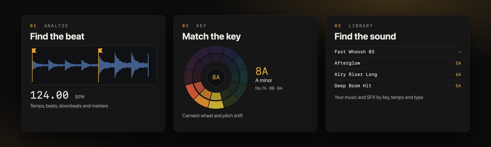
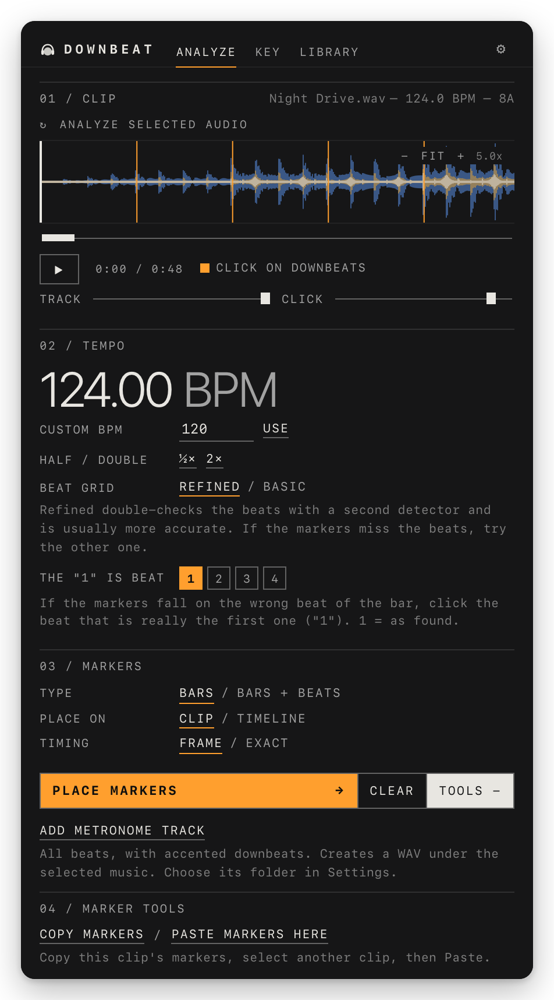
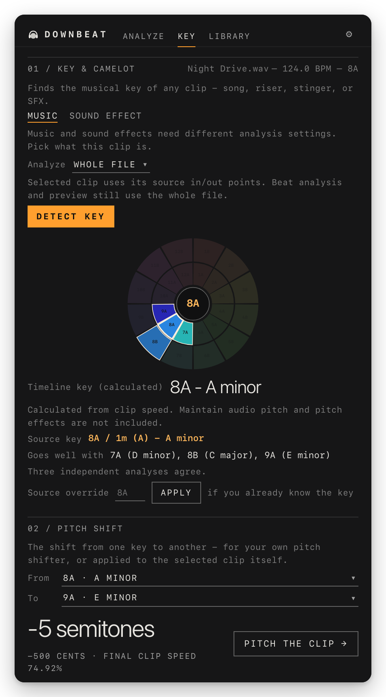
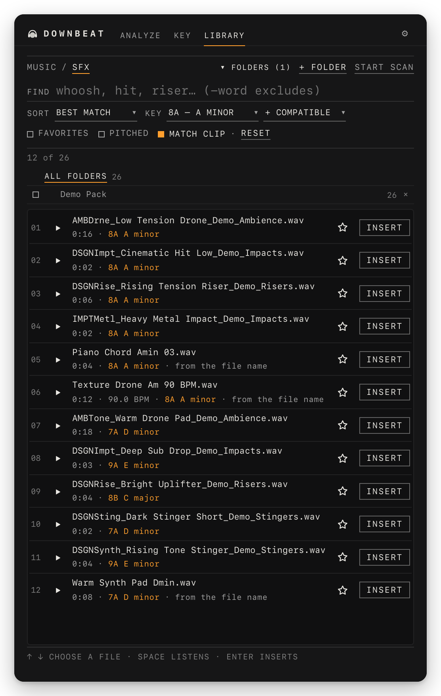
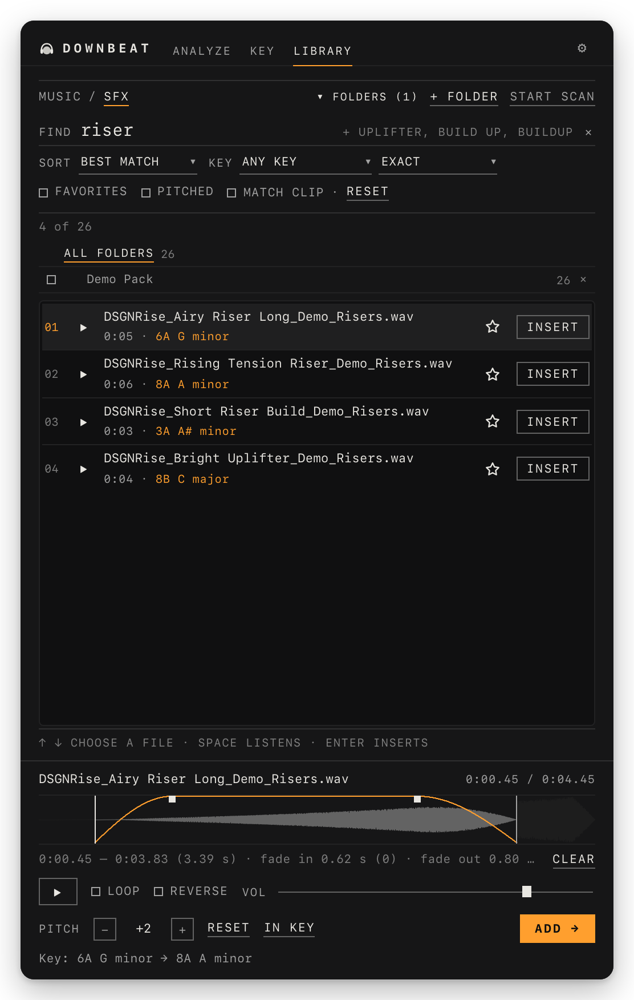

<h1 align="center">
   
  Downbeat
</h1>

  <b>Find the beat, match the key and pick the right sound without leaving Premiere Pro or After Effects.</b>

  
  
  
  
  
  
  

  
  

  The analysis can be wrong, so listen to the click track; fixing the tempo or the "1" takes one click. 
  User guide:
  <a href="GUIDE.md">English</a> &middot;
  <a href="GUIDE.ru.md">Russian</a> &middot;
  <a href="GUIDE.es.md">Spanish</a>

  

## Why editors use it

Cutting a video to music means getting three things right: the timing, the
key, and the music and effects you put on top. Downbeat handles all three in
one panel inside Premiere Pro and After Effects. It works for any edit cut to
music: reels and shorts, vlogs, music videos, weddings and events, trailers,
ads, documentaries, game montages.

| Find the beat | Match the key | Find the sound |
|---|---|---|
| Tempo, beats and the "1" of every bar, placed as markers. Clips snap to them, so once the detection is right, cutting a stack of clips to one track goes fast and the cuts land on the downbeat. | The key of every track in Camelot and note names, plus the keys that blend with it. Use it to join two songs that fit, or pitch one into the key of the other so they clash less. | Your own music and sound effects, searchable by key, tempo and sound type without leaving the app. Select the clip you are cutting, press **Match clip**, and the list shows what fits. |

A typical pass: analyze the track, check its key, find music and effects that
fit, and drop them on the timeline.

A montage also has to fit in key. A hit or a riser in the wrong key makes the
cuts sound like separate pieces, even when every one lands on the beat; in the
right key they play as one track. Downbeat shows the key of every clip and
sound, so you can pick the ones that match or pitch one into the key of the
other.

### Without Downbeat and with it

| | Without Downbeat | With Downbeat |
|---|---|---|
| Finding the tempo | Tap along and count by ear | Analyze gives the BPM, beats and downbeats in seconds |
| Cutting on the beat | Nudge every cut frame by frame, by eye and ear | Markers on every bar or beat, and clips snap to them |
| Knowing a track's key | Guess by ear or open another app | Detect key shows it in Camelot and note names, with the keys that fit |
| Joining two songs | Trial and error, and a clash shows up late | Pick keys that blend, or pitch one clip into the key of the other |
| Finding a sound | Search file names, scroll folders, audition one by one | Search by key, tempo and category ("swoosh" finds your whooshes); Match clip shows only what fits |
| A riser or hit in the right key | Pitch it in another tool, export, import again | Preview it with pitch, reverse and fades, then insert |
| Getting it on the timeline | Leave the app and drag files around | One click puts your original file at the playhead |

Downbeat is free and works offline. It uploads nothing and never changes your
original files.

## What it does

  
  

### Analyze

Analyze finds the tempo, the beats and the downbeats with two detectors, a
classic algorithm and the Beat This! model (it runs on your computer), and puts
a marker where it hears each one. In Premiere, turn snapping on (<kbd>S</kbd>)
and the Razor tool (<kbd>C</kbd>) snaps to those markers, so cutting a track to
the beat takes minutes.

Before you cut, press play and listen to the click on every downbeat. If
something is off, fix it with the controls below; [Known limits](#known-limits)
lists the tracks where that happens most.

- **Bars** puts one marker on the "1" of every bar, for a calmer edit on the
  strong beats. **Bars + beats** marks every beat for a fast edit and keeps the
  downbeats apart from the other beats. You can switch any time: placing
  markers again replaces only that clip's old Downbeat markers and leaves
  yours and other clips' alone, even where clips overlap. **Clear** removes
  Downbeat's markers from every piece of a clip you have cut.
- Markers go on the clip or on the timeline. Clip markers move with the clip
  when you move or trim it; timeline markers stay in the sequence.
- By default each marker sits at the start of the video frame the beat falls
  in, so a cut lands on the beat or up to one frame early, never late.
- In Premiere Pro, markers can sit on the exact audio sample. Choose
  **Timing → Exact** and turn on **Show Audio Time Units** in the Timeline
  panel menu; the ruler then counts audio samples, and you can cut between
  frames right on the beat. **Shift − / +** nudges the whole track 1 ms at a
  time.
- If the tempo is wrong, halve or double it, pick which beat is the "1", or
  type your own BPM, then check the result on the click track.
- **Refined / Basic** switches between the two detectors' results in one
  click, for when the markers miss the beats.
- You can copy markers from one clip and paste them onto another in the same
  app; the source keeps its markers. Positions are counted from where the clip
  becomes audible and follow the target's trim and speed. In Premiere, markers
  pasted onto another clip of the same song keep their place in the song.
  Comments, duration and other supported marker data come along.
- **Add a metronome track** renders the current beat grid as a WAV and
  inserts it below the selected music. The WAV goes to the finished-audio
  folder you choose in Settings.

### Key

Key shows the musical key in Camelot and note names. For music, three analyses
vote on it. For a riser or a hit, pick **Sound effect** and the analysis is
tuned for short sounds; there the key is only a hint. A pitch shift calculator
gives the semitones, cents and speed to enter in your own pitch shifter, and
**Pitch the clip** changes the clip's speed to move it into another key, the
way a sampler does. Your audio file is never rewritten.

- **Whole file** detects the key of the whole song, **Selected clip** only of
  the part the clip uses.
- The big result, the wheel, the keys that fit, **Match clip** and **In key**
  all use the key the clip plays at on the timeline, worked out from its
  speed. The file's own key is still shown as **Source key**.
- If you already know the key, type it in **Source override**; **Use detected
  key** brings the analysis back.
- **Pitch the clip** starts from the clip's current speed, so two +2 shifts
  make +4. Downbeat's markers don't carry over to the pitched clip, so analyze
  it again. Your own markers do carry over, and the original clip keeps its
  own.

### Library

The Library holds your own music and sound effects and shows the key next to
every file. Select the song you are cutting, press **Match clip**, and the
list narrows to the sounds that fit it.

  
  

- The key and tempo of every file, like `8A · A minor` or `124 BPM`, are found
  when you scan your folders.
- A music file's key comes from three methods. The row says *key agreed* when
  at least two of them found the same key, and *key uncertain* (in red) when
  all three differ, so you know which files to check by ear.
- Many sample packs put the key in the file name (`Pad Amin`,
  `Bass Fm 128 BPM`, `Key Emaj`, `8A - 128 - …`). Downbeat reads it, trusts it
  over its own guess and marks the row *from the file name*, so you can see
  which keys came from the pack. If the name gives everything (the key, and
  for music the tempo too), the file is ready at once, with no analysis.
- Most whooshes, footsteps, wind and rain have no note in them. They show "no
  clear pitch", and a key search skips them. Only tonal sounds (risers,
  drones, stingers, pads, bass hits) get a key, and even that is a hint to
  check by ear.
- **Match clip** shows only sounds in the same or a neighboring key (and, for
  music, the same tempo), so you stop auditioning files that clash.
- Search knows the sound-effect categories and their synonyms, so typing
  "swoosh" finds your whooshes.
- You can filter by key (exact or compatible) and by BPM (a range, with half
  and double tempo), show only favorites (★) or only pitched sounds, and sort
  by match, name, length or tempo. Click a row, then press Space to listen or
  Enter to insert.
- Tick folders to search only those. Files on a drive that is not connected
  stay in the list, marked, and come back with the drive. A file deleted from
  a connected folder leaves the list at the next scan, unless it has a star or
  a key you set by hand. A moved file keeps its analysis and its star.
- Music and SFX use separate audio folders that can't overlap. You can add a
  whole drive, a memory card or a network share, but not the system disk. A
  folder that can't be read keeps its records and favorites, and **Start
  scan** retries files that failed. **Settings → Library → Save a copy / Load
  a copy** backs up the whole library.
- The preview in the panel has play, loop, reverse and volume. Drag across the
  waveform to use only part of the sound, and drag the fade handles for a
  fade in and a fade out.
- A sound can be pitched up or down by up to 12 semitones, like on a sampler,
  so higher also means faster and shorter. The panel shows the new key:
  `6A G minor → 8A A minor`. Press **In key** and every sound you listen to is
  already pitched into your song's key.
- Sounds go in at the playhead as your original file. The trim, fades, pitch
  and reverse are set on the clip, and Downbeat never writes a processed copy
  of your audio.

## Install

You need Premiere Pro 2025 (25.0) or After Effects 2025 (25.0) or newer;
Downbeat is tested on the 2026 versions. It runs on macOS 13.5 or newer (Apple
Silicon or Intel) and on Windows 10 or 11 (x64). Windows on Arm is not
supported yet.

1. Download the `.zxp` for your system (`-mac` or `-win`) from the
   [latest release](https://github.com/ominousopera/Downbeat/releases/latest).
2. Drag it onto [ZXP Installer](https://aescripts.com/zxpinstaller/) (free),
   restart Premiere Pro or After Effects, then open
   `Window > Extensions > Downbeat`.

The package is signed with a self-signed certificate, so you don't need
Terminal commands or `PlayerDebugMode`. Each package contains Node.js for its
own platform only; if you installed the wrong one, Analyze tells you. To
uninstall Downbeat, use Remove in the ZXP installer. The changes in each
version are in [CHANGELOG.md](CHANGELOG.md).

To build from source, see [DEVELOPMENT.md](DEVELOPMENT.md).

<b>Privacy and security</b>

Everything runs on your computer. The panel goes online only for the release
checks you start yourself and for optional background notifications, which are
off by default. `scripts/check-code.js` fails the build if code that could make
any other network call is added.

Settings and the track library are saved in `Documents/Downbeat`. Temporary
files go to a `Downbeat` folder in the system's temp folder, or to
`Documents/Downbeat/tmp` if that can't be used. Nothing is written inside the
plugin's own folder.

To report a vulnerability privately, use the repository's Security tab; see
[`SECURITY.md`](SECURITY.md).

## Known limits

Downbeat estimates the tempo, beats, bars and key from the audio, and it can
be wrong. That happens most on tracks with a changing tempo, a weak or unusual
beat, a long quiet intro or a time signature other than 4/4 (see below), and
on very short sounds. Play the click track and listen. If something is off,
use half / double tempo, pick the beat that is the "1", nudge with **Shift**,
or set the key by hand in **Source override**. The key of a sound effect is
only a hint, because many effects have no clear pitch. **Match clip** and
**In key** give you a shortlist to audition, and two sounds in matching keys
can still clash.

- Downbeat assumes four beats to a bar. On a track that is not in 4/4 the bar
  markers can be wrong; use **Bars + beats** there.
- The panel shows one BPM per track. The markers follow the beats it finds,
  and a sudden tempo change starts a new tempo line, but check such tracks on
  the click track.
- Sound effects get no tempo, and many have no clear pitch, so they get no key
  either. The key of a tonal effect is a hint, and sounds shorter than 10
  seconds carry a note that it is less reliable.
- Analyze reads WAV, AIFF, MP3, M4A / AAC and the audio of MP4 / MOV; convert
  other formats first. The Library can scan and preview FLAC and OGG files but
  not insert them, because Premiere Pro and After Effects don't import them.
- Analyze reads the whole file and handles about 30 minutes of audio. For
  anything longer (a DJ mix, a concert), save the part you need as a separate
  file. Detect key and the Library scan have no such limit. Audio shorter than
  2 seconds, or silent audio, is not analyzed.
- Downbeat is built around Premiere Pro, which gets every feature. After
  Effects gets fewer:
  - Markers go on whole video frames only, so there is no sample-accurate
    **Exact** timing and no **Shift**.
  - Analysis and markers work on layers with a constant positive Time
    Stretch. Reversed layers and Time Remap are refused.
  - You cut at the markers by hand with **J / K** and **Split Layer**; there
    is no Razor tool to snap to them.
  - A marker keeps only its short label.
  - Library sounds are added as a new layer. Fades become volume keyframes,
    and pitch and reverse are set through Time Stretch.

## FAQ

### Cutting to music

<b>Why cut on the beat, and why match the key?</b>

A cut off the beat feels wrong even when you can't say why. The notes matter
too: pieces in the same or a neighboring key sound like one track. Downbeat
marks the beats and shows the key, so you can get both right.

<b>How do I cut music so the edit can't be heard?</b>

Stay on the beat, cut on a downbeat, and keep whole phrases (often 4, 8 or 16
bars). For a fade, use a riser or a fill the song already has, and add a very
short crossfade so the join doesn't click. Downbeat's markers and click track
help with the first three.

<b>How do DJs mix tracks, and what can an editor take from that?</b>

A DJ matches the tempo of two tracks, brings the new one in on the first beat
of a bar where a phrase starts, and picks a key that fits. You can do the same
when you join music in an edit: Downbeat shows the tempo, the bar markers and
the key.

<b>How do I join two different songs?</b>

Check the tempo and the key. Close tempos keep the pulse, and keys that are
the same or neighbors on the Camelot wheel blend. Analyze and Detect key give
you both; for your own music, **Library → Match clip** lists the tracks that
fit. Phrasing and mood still matter.

<b>Why use sound effects that are in key?</b>

Risers, booms, stingers and drones carry a note. If it doesn't fit the key of
the music, the effect sounds off even when it's on the beat. The Library shows
the key of every tonal effect, lists the ones that fit (**Match clip**) and can
pitch one into the key (**In key**).

<b>Why do I need a plugin for this?</b>

Most editors find the tempo, the bars, the key and the right sound by ear, by
tapping along or in separate apps, and that takes time. Downbeat does it in
one plugin, and you don't need to know music theory.

### Using Downbeat

<b>Where does Downbeat fit in a typical project?</b>

A common order for a motion design or edit project: cut the music in Premiere
Pro first and build an animatic (it shows the client the pacing: where the
video speeds up, pauses or changes mood), animate in After Effects, then come
back to Premiere Pro for the sound design and the mix.

While you cut the music, Analyze puts markers on the bars and beats, the click
track lets you check them, and Detect key with the Library helps you pick a
second song that fits. During sound design, the Library finds effects by type
and key, plays them already pitched into the song's key and adds them at the
playhead.

Premiere Pro is the better place for the music work. Besides its audio mixer
and VST plugins, it has **Show Audio Time Units**, which lets you cut audio
between video frames, down to single audio samples.

<b>How does the analysis work?</b>

Everything runs on your computer; nothing is sent anywhere.

For tempo, beats and bars, two detectors listen to the same audio. One is a
classic beat tracker from the open-source [essentia](https://essentia.upf.edu/)
library, which finds the tempo and the beats. The other is Beat This!, a small
neural network that finds beats and downbeats (the first beat of each bar).
Downbeat uses the network's beats only if they pass checks against the classic
ones (for example, the network must not hear the track at half or double
speed); otherwise the classic beats stay.

Either way, the bars are counted over the whole song from the network's scores
for every moment, with the bar-tracking method of Krebs, Böck and Widmer, on
whichever beats were kept. That way the "1" comes every four beats and doesn't
jump to a loud beat. If the network can't count the bars, Downbeat picks the
first beat of each bar by weighing the low-end energy and the chord changes at
each beat. Last, the beat times are evened out along the local tempo line and
corrected for the detectors' delay, and each marker is placed at the start of
the video frame its beat falls in (or at the exact time, in Premiere Pro with
**Timing → Exact**).

For the key, three independent analyses vote: classic key profiles
(essentia), the chord progression, and S-KEY, a small neural network trained
on music. The profile result stands unless the chord analysis and S-KEY agree
with each other on a different key; then theirs wins. Sound effects use a
different setup: a longer analysis window and no S-KEY, since it was trained
on music.

To stay fast, the Library scan reads only part of each file. It finds the key
and, for music, the tempo, and it decides whether a sound effect has a clear
pitch at all. A key or tempo written in the file name is used as it is.

The results are estimates; see [Known limits](#known-limits). The components
and their licenses are listed in [`NOTICE.md`](NOTICE.md).

<b>Does it work offline? Is anything uploaded?</b>

Analysis and the Library work offline. Nothing is uploaded, and there is no
account and no analytics.

The only network request the panel makes is the update check.
**Settings → Updates → Check now** asks GitHub once. Optional notifications
check every three days and are off by default. **Open the release page** opens
the new release in your browser; you download it, install it with a ZXP
installer and restart the Adobe app yourself. The panel never downloads or
installs packages. No personal content is sent, though GitHub sees your IP
address, as any website does. Feedback and release-page links ask for
confirmation before they open in your browser.

<b>A security tool (BlockBlock, Little Snitch…) asks about <code>node</code>. What is it?</b>

It's Downbeat's own analysis. Analyze, Detect key and the Library scan run in
a copy of Node.js that ships inside the plugin, signed by the Node.js
Foundation. It starts <code>analyze-worker.js</code>,
<code>beatthis-worker.js</code> or <code>skey-worker.js</code> from the
plugin's <code>worker</code> folder, works only on your computer and doesn't
connect to the internet. Allow it permanently (not "once" or "temporarily")
and the questions stop.

<b>Does it change my audio files?</b>

No. Downbeat never modifies your files and never writes a processed copy of
them. Sounds go on the timeline as your original file, with the trim, fades,
pitch and reverse set on the clip itself. Downbeat's own files are the
settings and the track library in <code>Documents/Downbeat</code>, plus
short-lived temporary files in a <code>Downbeat</code> folder inside the
system's temp folder; <b>Settings → Delete my data</b> removes them. Metronome
WAVs are saved to the <b>Finished audio</b> folder, and Delete my data leaves
them alone.

<b>Which key do Pitch the clip, Match clip and In key use?</b>

The key the selected clip plays at, which Downbeat works out from the clip's
speed. Detect key measures the source file or the selected part of it, and a
key you typed as a source override stays with that source. Speed changes pitch
the way it does on a sampler, so two +2 semitone shifts add up to +4. Maintain
Audio Pitch and audio effects are not taken into account. At a speed that
falls between whole semitones there is no exact Camelot key to aim for.

<b>How do I copy markers from a trimmed clip?</b>

Use **Marker tools → Copy markers**, select the target clip, then
**Paste markers here**. The source keeps its markers. Positions are counted
from where each clip becomes audible. In Premiere, markers pasted onto another
clip of the same file keep their place in the song, so beat markers stay on
the beat however the two clips are trimmed. Within the same app the supported
marker data comes along. Markers that would start outside the target clip are
skipped, though a marker's duration can run past the clip's end. If the
selection or the timing changes while Downbeat is copying or pasting, it
stops before changing anything.

<b>What is the Camelot wheel?</b>

A DJ notation for the 24 musical keys: the numbers 1 to 12 around a wheel plus
a letter, <b>A</b> for minor and <b>B</b> for major, so <code>8A</code> is A
minor and <code>8B</code> is C major. Keys next to each other on the wheel (one
number up or down with the same letter, or the same number with the other
letter) blend well. Downbeat shows the Camelot code next to the note name and
lists the keys that go well with the one it found.

<b>Which sounds can I put in the Library?</b>

Any folder with audio files (WAV, AIFF, MP3, M4A, AAC, FLAC, OGG), added as
<b>Music</b> or <b>SFX</b>. You can add a whole drive, memory card or network
share, but not the system disk; keep Music and SFX folders separate. A scan
reads the key and, for music, the tempo. Sound effects get no tempo, and most
have no pitch either, so they show "no clear pitch" and a key search skips
them. FLAC and OGG files can be scanned and previewed but not inserted,
because Premiere Pro and After Effects don't import them.

<b>Start scan</b> retries files that failed, and <b>Cancel</b> stops the work
still in the queue. A folder that can't be read keeps its saved records. If a
file is replaced at the same path, its preview reloads before it is inserted.

<b>Does it work with any time signature?</b>

Downbeat assumes four beats to a bar and has no time-signature detection. On a
track that is not in 4/4 the downbeat pick can look confident and still be
wrong; **Bars + beats** is the safer choice there.

<b>Do I need to cut by hand after Analyze?</b>

Yes. Downbeat places the markers, and you make the cuts. In Premiere Pro, with
snapping on, the Razor tool snaps to the markers, so each cut takes a few
clicks.

<b>Which versions are supported?</b>

Premiere Pro 2025 (25.0) or newer and After Effects 2025 (25.0) or newer;
older versions can't open the panel. Downbeat is tested on the 2026 versions
of both. On a Mac it needs macOS 13.5 or newer (Apple Silicon or Intel),
because the bundled Node.js that runs the analysis needs it. On Windows it
needs Windows 10 or 11 (x64); Windows on Arm is not supported yet. The
interface is in English, Russian and Spanish. Analyze reads what the host can
put on a timeline and the panel can decode: WAV, AIFF, MP3, M4A / AAC, and
the audio of MP4 / MOV.

## Thanks

Special thanks to **Ilya Rogulev**, who tested Downbeat on Windows and
Premiere Pro and After Effects through every round of fixes: the folder
dialogs, the fades and the reversed layers on Windows all got their answers
from his logs.

Special thanks to **Vladislav Baranov** for his ideas and hints on how to
make the plugin better.

## License

Downbeat is licensed under AGPL-3.0; see [`LICENSE`](LICENSE). Third-party
components are listed in [`NOTICE.md`](NOTICE.md). The weights of the S-KEY
key model (`models/skey.onnx`) are not covered by the AGPL: their authors
limit them to non-commercial research use (details in `NOTICE.md`).

Guide: [English](GUIDE.md) · [Russian](GUIDE.ru.md) · [Spanish](GUIDE.es.md).
Contributing: [`CONTRIBUTING.md`](CONTRIBUTING.md). Development:
[`DEVELOPMENT.md`](DEVELOPMENT.md).

Built with the help of Claude Code.

---

If Downbeat saves you time, a star helps other editors find it.
